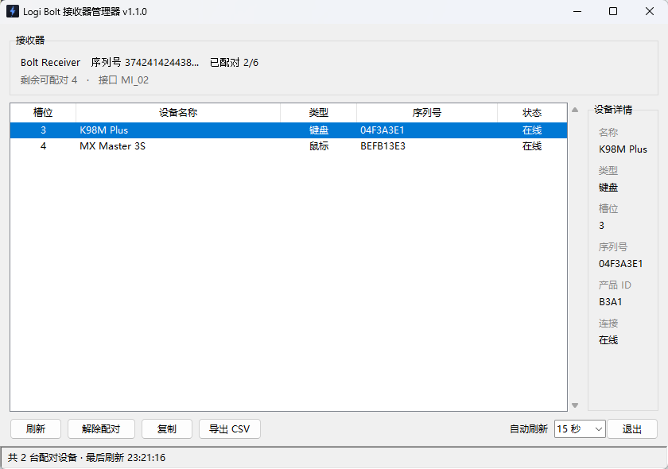

# Logi Bolt 接收器管理器 · BoltManager


**Windows 上的罗技 Logi Bolt 接收器小工具**：读取接收器里已配对的设备清单，把不用的设备从接收器里清掉。
底层复用 [Solaar](https://github.com/pwr-Solaar/Solaar) 的 HID++ 协议实现，并为 Windows 的 HID 传输层打了补丁。

> **English**: A small Windows GUI/CLI to list and unpair devices on a Logitech **Logi Bolt** receiver
> (`046D:C548`). Solaar 1.1.20 already speaks the Bolt protocol, but its HID layer assumes one handle can
> send both short and long HID++ reports — which Windows forbids for this receiver. This project ships the
> minimal fix (`patches/`, 4 files, +138/−3 lines) plus a tkinter front-end.



## 这个工具解决什么问题

Logi Bolt 接收器在设备管理器里看着一切正常，但你会遇到这些情况：

- 换过键鼠之后，**旧设备仍然占着接收器的配对槽位**，官方 Options+ 里根本不显示它们；
- 手头只有接收器、没有官方软件，想知道"这颗接收器到底认过哪几台设备"；
- 设备配对错乱，需要把某个槽位**强制解除配对**再重新配对。

Solaar 能干这些事，但它官方只支持 Linux；在 Windows 上直接装，会遇到接收器枚举不到的问题
（原因见 [docs/技术说明.md](docs/技术说明.md)：Bolt 接收器把长短报文拆成两个 HID 集合，
而 Windows 严格校验报文长度，单句柄走不通）。

## 功能

- 列出接收器上所有配对设备：槽位、名称、类型（键盘/鼠标…）、序列号、产品 ID (WPID)、在线状态
- 解除指定设备的配对（写 Bolt 配对寄存器，不动设备本身，之后可重新配对）
- 显示接收器信息：序列号、已配对数量/上限、剩余可配对数
- 检测 Logi Options+ 等官方软件是否在运行（它们可能独占接收器）
- GUI：设备详情面板、复制到剪贴板、导出 CSV、自动刷新、高 DPI、窗口位置记忆、单实例保护
- 命令行模式：`--list` / `--info` / `--unpair` / `--watch`，全程支持 `--json`
- 打包成单目录 exe，目标机器不需要装 Python

## 快速开始

### 方式一：用现成的 exe（普通用户）

1. 从 [Releases](../../releases) 下载 `BoltManager-<version>-win64.zip`
2. 解压到任意目录（**必须整个文件夹一起**，`BoltManager.exe` 依赖同目录的 `_internal/`）
3. 双击 `BoltManager.exe`，插着 Bolt 接收器即可看到设备列表

> 首次运行若被 SmartScreen 拦下：这是未签名的开源程序，点"更多信息 → 仍要运行"。

### 方式二：从源码运行（开发者）

```bat
git clone <this-repo> && cd logi-bolt-manager
python -m venv .venv && .venv\Scripts\activate

:: 注意必须分两步：solaar 的依赖声明里有 Windows 装不上的 PyGObject
pip install --no-deps solaar==1.1.20
pip install -r requirements.txt

:: 关键两步：应用 Windows 传输层补丁 + 下载官方 hidapi.dll
python tools\apply_patches.py
python tools\fetch_hidapi.py

python src\bolt_manager.py --list      :: 先确认能读到设备
python src\bolt_manager.py             :: 打开图形界面
```

## 用法

### 图形界面

| 操作 | 说明 |
| --- | --- |
| 刷新 | 重新读取接收器（读 HID 会阻塞，已放到后台线程） |
| 解除所选设备配对 | 选中行后点击，或双击该行 / 按 Delete；有二次确认 |
| 复制 | 把设备清单以 TSV 复制到剪贴板，可直接粘进 Excel |
| 导出 CSV | 导出为 utf-8-sig 编码的 CSV，Excel 双击打开不乱码 |
| 自动刷新 | 关闭 / 5 / 15 / 30 / 60 秒定时重读，检测设备增减 |
| 设备详情面板 | 右侧显示选中设备的类型、产品 ID、序列号、连接状态 |
| 状态栏 | 设备数量、最后刷新时间、错误信息、Options+ 占用警告 |

窗口大小/位置和自动刷新设置保存在 `%APPDATA%\BoltManager\settings.json`。
同一时刻只允许运行一个 GUI 实例（第二个实例会弹窗提示），避免两个进程抢接收器。

### 命令行

```bat
python src\bolt_manager.py --list              :: 人类可读
python src\bolt_manager.py --info              :: 接收器信息 + 设备详情
python src\bolt_manager.py --list --json       :: 机器可读，便于脚本消费
python src\bolt_manager.py --unpair 3 --yes    :: 解除槽位 3（非交互必须 --yes）
python src\bolt_manager.py --watch 2           :: 每 2 秒轮询，只在变化时输出
python src\bolt_manager.py --version
python src\bolt_manager.py --list --debug      :: 打印 solaar/hidapi 调试日志
```

`--list --json` 输出示例：

```json
{
  "ok": true,
  "name": "Bolt Receiver",
  "serial": "3742414244384541…",
  "max_devices": 6,
  "paired": 2,
  "devices": [
    { "slot": 3, "name": "Alto Keys K98M Plus", "serial": "04F3A3E1",
      "wpid": "B3A1", "kind": "keyboard", "online": true,
      "kind_label": "键盘", "status": "在线" },
    { "slot": 4, "name": "MX Master 3S", "serial": "BEFB13E3",
      "wpid": "B035", "kind": "mouse", "online": true,
      "kind_label": "鼠标", "status": "在线" }
  ]
}
```

读不到接收器时返回非 0 退出码，JSON 为 `{"ok": false, "error": "..."}`。

> **在线状态的说明**：`online` 读的是接收器当时上报的连接状态，设备休眠时会显示"离线"，
> 这不代表配对丢了。配对记录（槽位/名称/序列号）才是接收器寄存器里的持久数据。

## 目录结构

```
logi-bolt-manager/
├─ src/
│  ├─ bolt_core.py           # 数据层：接收器会话、格式化、设置、单实例锁（无 GUI 依赖）
│  ├─ bolt_manager.py        # CLI + tkinter GUI
│  ├─ gen_icon.py            # 纯 Python 生成 bolt.ico（无第三方依赖）
│  ├─ bolt.ico
│  └─ BoltManager.spec       # PyInstaller 打包配置（路径自动推导）
├─ tests/                    # pytest 单元测试（不需要插硬件）
├─ patches/                  # 对 Solaar 1.1.20 的补丁（unified diff）
│  ├─ hidapi/hidapi_impl.py.patch
│  └─ logitech_receiver/*.patch
├─ tools/
│  ├─ apply_patches.py       # 应用/撤销/检查补丁（跨平台）
│  ├─ make_patches.py        # 从当前环境重新生成 patches/
│  ├─ fetch_hidapi.py        # 下载官方 hidapi.dll（sha256 校验）
│  ├─ verify_patches.py      # 无硬件自检（CI 用）
│  ├─ rebuild.cmd            # 一键打包 exe
│  └─ solaar-cli.cmd         # 直接调用 solaar CLI，排查用
├─ docs/
│  ├─ 技术说明.md            # 根因分析、补丁逐条讲解、升级清单
│  └─ screenshot.png
├─ dist/BoltManager/         # 打包产物（不入库）
├─ LICENSE                   # GPL-2.0
└─ THIRD-PARTY-NOTICES.md    # 第三方组件与许可
```

## 从源码构建 exe

```bat
pip install --no-deps solaar==1.1.20
pip install -r requirements-dev.txt
python tools\apply_patches.py             :: 应用补丁
tools\rebuild.cmd                          :: 自动下载 hidapi.dll 并打包 → dist\BoltManager
```

`src\BoltManager.spec` 按优先级查找 `hidapi.dll`：环境变量 `HIDAPI_DLL` → `build/hidapi/`（fetch 脚本产物）
→ Python 安装目录。CI（`.github/workflows/ci.yml`）跑的就是这套流程，打 `v*` 标签会自动把
exe + LICENSE + 补丁一起打包成 Release 附件。

## 开发与测试

```bat
python -m pytest tests -q        :: 单元测试，不需要插接收器
python tools\verify_patches.py   :: 无硬件自检：补丁指纹 + 导入链路
python -m ruff check src tools tests
```

数据层 `src/bolt_core.py` 不依赖 tkinter，可被脚本直接复用：

```python
import bolt_core

info = bolt_core.snapshot()          # 读一次接收器
for d in info.devices:
    print(d.slot, d.name, d.kind_label, d.status_label)

bolt_core.unpair_device(3)           # 解除槽位 3
```

## 补丁机制

`patches/` 里是**标准 unified diff**，不是"改好的整份文件"，这样一眼能看出改了哪几行、方便 review
和向上游提 PR：

| 补丁 | 改动量 | 作用 |
| --- | --- | --- |
| `hidapi/hidapi_impl.py.patch` | +109 / −0 | Bolt 接收器双集合虚拟句柄；`0x83` 长寄存器读改走短报文 |
| `logitech_receiver/base.py.patch` | +11 / −1 | `0x83` 长寄存器读也按 20 字节长报文封装 |
| `logitech_receiver/receiver.py.patch` | +9 / −1 | `extract_serial()` 容错 `None` 回复 |
| `logitech_receiver/desktop_notifications.py.patch` | +9 / −1 | 通知探测多捕获 `ImportError`（无 GTK 环境） |

```bat
python tools\apply_patches.py --check     :: 只检查，不落盘
python tools\apply_patches.py             :: 应用（幂等，重复执行不会出错）
python tools\apply_patches.py --revert    :: 逐字节还原成上游原样
```

补丁钉在 `solaar==1.1.20` 上，版本不符会明确报错而不是硬套。升级流程见
[docs/技术说明.md 第 8 节](docs/技术说明.md#8-升级-solaar-时要做的事)。

## 已验证环境

| 项 | 值 |
| --- | --- |
| 系统 | Windows 10 / 11 x64 |
| Python | 3.13 |
| Solaar | 1.1.20（`patches/` 基于其原始源码生成） |
| 实测设备 | Logi Bolt 接收器 + MX Master 3S、Alto Keys K98M Plus（槽位 3/4） |

## 已知限制

- 只做"列设备 + 解配对"；**配对新设备、DPI、按键重映射请用官方 Options+**。
  配对需要接收器进入发现模式并等待设备端的 DJ_PAIRING 通知，没有常驻监听线程时做不完整，
  所以这里没有实现"半成品配对按钮"。
- 电池、固件版本读不到：这些要走 HID++ 2.0 的设备级通道，在 Bolt/Windows 下通常不响应
  （`protocol` 报 0）。本项目只展示接收器寄存器里能可靠读到的信息。
- `online`（在线/离线）是接收器上报的瞬时状态，设备休眠时会显示"离线"，不代表配对失效。
- Logi Options+ 运行时会占用接收器；读取通常仍可用，但**解除配对**前建议先退出。
- 未做代码签名，Windows 可能弹 SmartScreen 提示。
- 仅 Windows。Linux 用户请直接用 Solaar（功能更全）。

## 常见问题

**提示"未找到 Logi Bolt 接收器"？**
接收器没插好、插在劣质 USB Hub 上、或被 Options+ 独占。换个直连 USB 口试试，并确认设备管理器里
`USB 输入设备` 下存在 `MI_02` 接口。

**exe 换台机器打不开？**
只拷了 exe。必须连 `_internal/` 目录一起拷。

**解除配对失败？**
先退出 Logi Options+ / Logi Tune；再确认没有别的程序（GHUB、LGSTrayEx 等 HID++ 客户端）在占用。

**想确认补丁是否生效？**
```bat
python -c "import hidapi.hidapi_impl as h; print(hasattr(h,'_BoltSplitHandle'))"
```
返回 `True` 即已打补丁。完整的无硬件自检是 `python tools\verify_patches.py`（6 项）。

**读到的设备显示"离线"？**
设备休眠了。按一下键或移动鼠标再点刷新即可，配对记录本身没有丢。

## 参与贡献

欢迎提 Issue / PR。请先读 [CONTRIBUTING.md](CONTRIBUTING.md)。特别欢迎两类反馈：

- 更多 Bolt 设备（尤其是键盘/耳机）的实测结果，用于补全兼容性表；
- 上游 Solaar 若已合并等价修复，请告知，本项目可以体面退休。

## 许可与致谢

- 本项目以 **GPL-2.0-or-later** 发布，见 [LICENSE](LICENSE)。之所以不是 MIT：`patches/` 修改了
  GPL 项目 Solaar 的源码，衍生作品必须同许可。
- 感谢 [Solaar](https://github.com/pwr-Solaar/Solaar) 作者 Daniel Pavel 与所有贡献者，
  本项目的协议层几乎全部来自 Solaar。
- 第三方组件（hidapi、OpenSSL、Tcl/Tk 等）的许可见 [THIRD-PARTY-NOTICES.md](THIRD-PARTY-NOTICES.md)。
- 分发本项目的二进制时，请一并保留 `LICENSE` 与本声明文件，并提供源代码获取方式（GPL 要求）。

**商标声明**：Logitech、Logi、Bolt、MX 是 Logitech Europe S.A. 的商标。本项目是非官方第三方工具，
与 Logitech 无隶属或背书关系。

---

如果这个工具帮你救回了一颗"失踪"的接收器，给个 ⭐ 就好。
